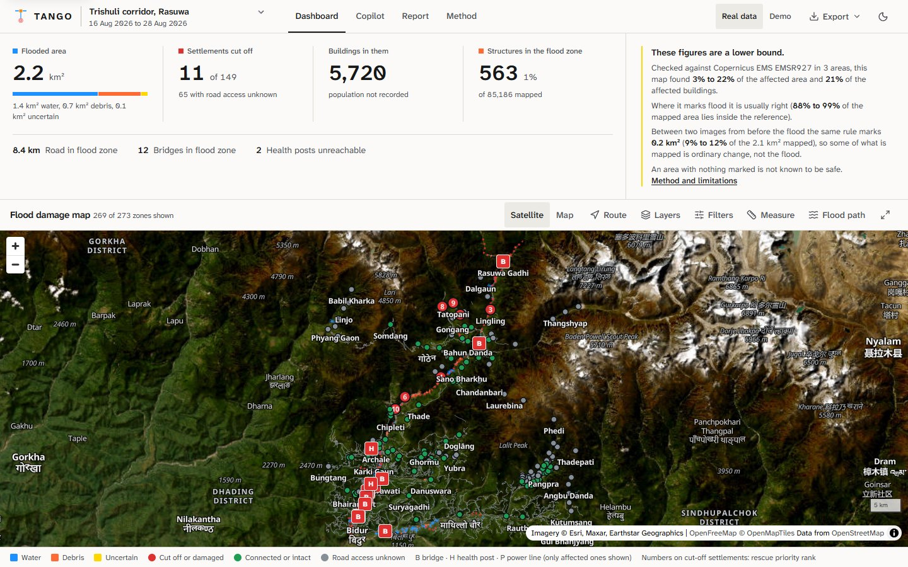
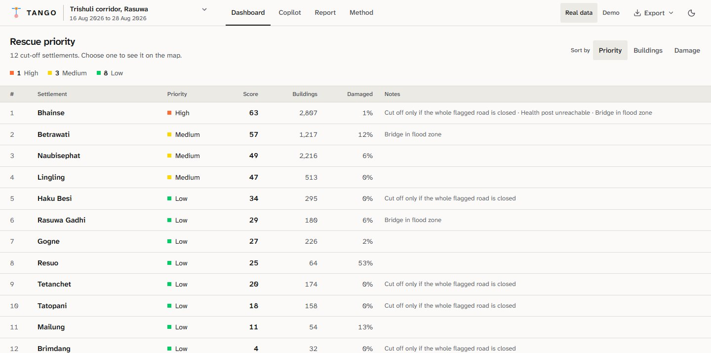
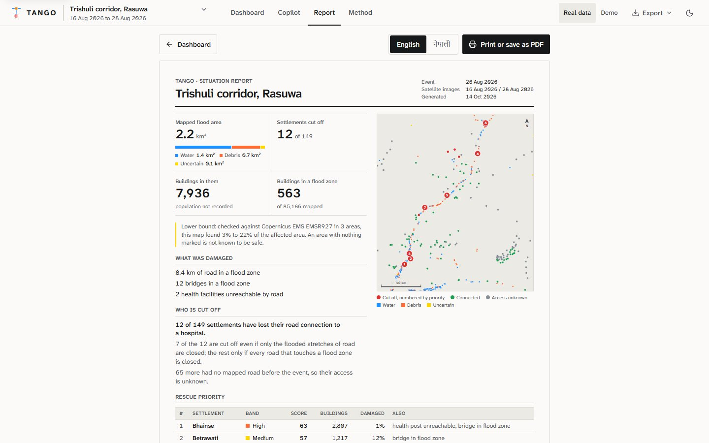
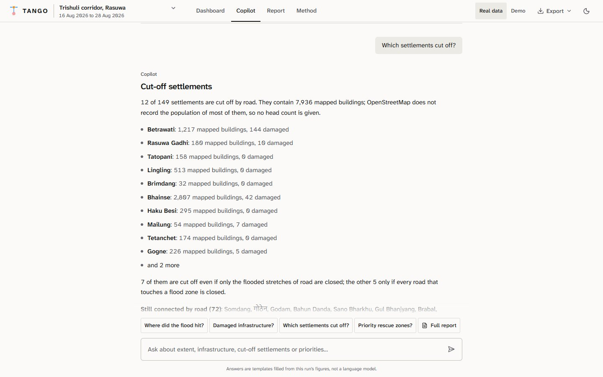

# TANGO: Flood Response System

**Mapping flood damage from space, for rescue teams.** Give TANGO an area and a flood date. It compares Sentinel-1 radar scenes from before and after, maps flood water and debris, overlays pre-event OpenStreetMap buildings, roads and bridges, finds the settlements that have lost their road connection to a hospital, and writes a one-page situation report in English and Nepali. Case study: the Trishuli flood, Nepal, 26 August 2026.

An entry to Space Track, Track B (*Mapping Flood Damage from Space*) of the Multimodal AI Hackathon 2026. An educational prototype, not an operational tool.

| | |
| --- | --- |
| Live dashboard | <https://bhoopesh282008.github.io/Tango/> (six areas on real data: the case study, the flood model's map of the same scenes, a second reach and three rehearsals; the header's **Demo** switch shows the bundled demo dataset) |
| Demo video | _added at submission_ |
| Report (6 pages) | [docs/report.pdf](docs/report.pdf), source [docs/report.md](docs/report.md) |
| Method and limits | the dashboard's **Method** page, and section 7 of the report |
| Licence | MIT for the code; the data keeps its own terms (see [Attribution](#attribution)) |



## The three questions

| Question | What TANGO does | Where to look |
| --- | --- | --- |
| Where did the flood hit? | Compares a Sentinel-1 pair on the same orbit track (the median of three earlier images as the baseline), only on valley floors found from the Copernicus DEM and mapped rivers. Classes: water, debris, uncertain | Dashboard figures and map, the before/after viewer |
| What was damaged? | Pre-event OpenStreetMap buildings, roads and bridges that fall inside the zones. Roads and bridges are "in flood zone", not "destroyed" | Dashboard, `/report` |
| Who is cut off? | Settlements that could reach a hospital by road before the event and cannot now; "access unknown" where the map has no road | Rescue priority table, map markers, the Route tool |

Also: a route planner that avoids flooded road sections, with live GPS navigation; the bonus flood-path trace from any point upstream; a copilot that answers four questions and writes the situation report in English and Nepali from the run's own figures (templates, not a language model; the Nepali is unreviewed); and a one-page report that prints to A4. The AI component is a flood segmentation model, a small U-Net trained on Kuro Siwo ([pipeline/MODEL.md](pipeline/MODEL.md)).

<p align="center">
  
  
  
</p>

## What it found, and how far to trust it

| | |
| --- | --- |
| Trishuli corridor (case study) | 2.1 km² of flood zones (1.4 water, 0.7 debris) plus 0.1 km² uncertain; 12 of 149 settlements cut off (7 of them even if only the flooded stretches of road are closed), and 65 more with no mapped road, so their access is unknown. Sentinel-1D, track 85, 16 and 28 Aug 2026 |
| Checked against Copernicus EMS EMSR927 (checking only) | Where it marks flood it is usually right (precision 0.88 to 0.99), but it finds only 3% to 22% of the reference area in the three reference areas inside the run, and 21% of the affected buildings. **Every figure is a lower bound.** |
| False alarms | The same rule on two images that are both from before the event marks 9% to 13% of its own area (the single-image rule marked 24% to 127%), so part of every map is ordinary change (`pipeline/null_test.py`) |
| A second reach, Lower Trishuli | 4.7 km² of flood zones, 16 of 116 settlements cut off (5 even if only the flooded stretches close), recall 0.22 to 0.35 at precision 0.94 to 0.97 |
| Rehearsals on new ground | The Bhote Koshi in Sindhupalchok on the event date and on a dry-season date (the rule maps 3.3 times the area in August as in February; no flood there is confirmed, and the seasons differ), the 2021 Chamoli glacier flood in Uttarakhand, and the 2023 South Lhonak glacial-lake flood down the Teesta valley in Sikkim (run from scratch in about 25 minutes, most of it waiting for the free OpenStreetMap service). Not checked against any reference map: they show that the system runs on a new event, not how well it maps it |
| Sentinel-2 optical (on by default) | Clear on both sides of the event for 31% and 55% of the two Trishuli areas. There it confirms 0.58 and 0.79 km² of the radar's detections and fills 0.07 and 0.08 km² of radar blind spots. Change only it sees (6.4 and 8.1 km² on valley floors) is recorded, not drawn; off the valley floor it was mostly cloud and haze. `--no-optical` gives a run about 17 minutes shorter |
| Flood model (AI component) | Flood IoU 0.46 against 0.27 for the threshold rule on Kuro Siwo test floods absent from training (0.55 against 0.34 for a smaller model trained with every test event held out). On the real Trishuli scenes it finds less than the rule (2% to 14% of the reference area against 3% to 22%), so the rule makes the map and the model checks it: run on the same images, it also marks 0.45 of the rule's 1.39 km² of water (32%; Lower Trishuli 49%), shown per zone on the dashboard. Its own map of the scenes is in the area list |
| VH band (tested, not adopted) | Adding VH to the change rule mapped 4.47 km² on Trishuli against 2.07, but also marked 14% and 16% of that between two images from before the flood, above a 15% bar set before the test. `--vh` still tries it |

What it cannot do: warn of a flood (Sentinel-1 returns every 12 days), see steep ground in radar shadow, count damage rather than overlap with a flood zone, or tell a cut-off settlement from one whose road was never mapped. The full list is section 7 of the report.

## Quick start

**Dashboard** (Node; the version is in `.nvmrc`):

```bash
git clone https://github.com/bhoopesh282008/Tango.git
cd Tango
npm install
npm run dev      # http://localhost:5173
```

A fresh clone has no run data (it is not in git), so the dashboard opens on the bundled **Demo data**; the live site shows six real areas. To make your own, run the **pipeline** (Python 3.11 to 3.13 and a free Copernicus Data Space account):

```bash
py -3.13 -m venv pipeline/.venv
pipeline/.venv/Scripts/python -m pip install -r pipeline/requirements.txt
cd pipeline
.venv/Scripts/python run.py --bbox <west,south,east,north> --event <YYYY-MM-DD> --out out/<folder> --name "<area name>" --publish
```

That is the whole system, end to end from raw Sentinel-1 data, for an area (up to about 0.2 square degrees) and a date you choose. It takes 3 to 16 minutes, longer when the free OpenStreetMap service is busy. Credentials, what each step does and what to do when it stops are under [Run the pipeline](#run-the-pipeline) and [On the day](#on-the-day-running-a-new-area).

## Run the dashboard

```bash
npm install
npm run dev      # http://localhost:5173
npm run test     # 319 tests
npm run lint
npm run build
```

A fresh clone has no run data (`public/data` is not in git), so the dashboard opens on the bundled demo dataset with a "Demo data" badge; run the pipeline (below) to see a real area. The first page load of the dev server takes about 20 seconds while it prepares its dependencies. Tested on a clean clone: `npm install`, `npm run test`, `npm run lint`, `npm run build`, then a Python 3.13 environment, `pip install -r pipeline/requirements.txt` (about four minutes, PyTorch included) and `pytest pipeline/tests` all pass. `npm install` reports advisories in development tools and in `react-router` server-side rendering, which this static app does not use.

`npm run test:a11y` runs axe-core accessibility checks in a browser; it needs `@playwright/test`, `@axe-core/playwright` and Chromium (`npm i -D @playwright/test @axe-core/playwright`, then `npx playwright install chromium`).

## Deploy (GitHub Pages)

The dashboard is a static site. The run data it shows (`public/data`, tens of megabytes) is not in git, so a build made from git has no data. The deploy script builds here, where the data is:

```bash
npm run deploy:pages            # build for the repository's Pages address and check it; pushes nothing
npm run deploy:pages -- --push  # publish to the gh-pages branch
```

It works out the address and base path from the git remote (`https://<owner>.github.io/<repo>/`), refuses to continue if a published run is missing a file, builds with that base path, adds `404.html` (so a refresh on `/Tango/copilot` still loads the app) and `.nojekyll`, and with `--push` force-pushes the finished folder as a single commit on `gh-pages`. That keeps the data out of the history of `main` and stops `gh-pages` accumulating copies of it. Once, in the repository's Settings, Pages, set the source to the `gh-pages` branch.

GitHub Pages cannot send response headers, so the Content-Security-Policy is a `<meta>` tag in the built page (`scripts/csp.mjs`; it lists the few map and imagery hosts the app uses). Continuous integration (`.github/workflows/ci.yml`) runs lint, the tests and a build at the Pages path; it does not deploy. Build for another path with `VITE_BASE=/other/ npm run build` (in Git Bash on Windows prefix the command with `MSYS_NO_PATHCONV=1`).

Each page shows its build (version, commit, date) in the footer, so what was seen can be tied to a commit.

The live site is <https://bhoopesh282008.github.io/Tango/>. GitHub Pages serves the `.geojson` files gzipped (checked: the 28.7 MB buildings file of Lower Trishuli travels as 3.6 MB), and answers a pasted deep link such as `/Tango/report` with `404.html`, which loads the app.

## Run the pipeline

Python 3.11 to 3.13 (the geospatial packages have no wheels for 3.14 yet). From the repository root, on Windows:

```bash
py -3.13 -m venv pipeline/.venv
pipeline/.venv/Scripts/python -m pip install -r pipeline/requirements.txt
pipeline/.venv/Scripts/python -m pytest pipeline/tests     # 201 tests
```

For GPU training install PyTorch from its own index first: `pip install torch --index-url https://download.pytorch.org/whl/cu124`.

A full run takes an area and a flood date, and `--publish` puts the result in the dashboard:

```bash
cd pipeline
.venv/Scripts/python run.py --bbox 85.1,27.9,85.5,28.3 --event 2026-08-26 --out out/trishuli --name "Trishuli corridor, Rasuwa" --publish
```

### Any area, any date

The system is built to be run on an area and date chosen on the day:

1. Pick the bounding box as `west,south,east,north` in degrees and the flood date.
2. Run the command above with them, a new `--out` folder and a `--name`. Without `--name` the area is named after its largest mapped settlement.
3. Reload the dashboard. The new area opens first, and the selector in the header switches between every published area.

Each published area lives in `public/data/<id>/` and is listed in `public/data/runs.json` (`publish.py`). The title, map view, statistics, before/after pictures, copilot answers, one-page situation report and flood-path terrain all follow the selected area. What stays tied to the Trishuli case study: the bundled demo data, six district labels on the map, and the wording of the Method and limitations page. `python publish.py <run folder> --name "..."` publishes a run made earlier.

A first run on a new area downloads its scenes, elevation and OpenStreetMap snapshot: OpenStreetMap is asked for at the start, in the background, so it arrives while the radar scenes are being read; the free service is sometimes busy for a quarter of an hour, and the pipeline keeps retrying for about 22 minutes before it stops with a message (run the same command again to continue from the cache). A re-run reuses the rasters and takes under a minute. Rehearsals so far: Trishuli, a second Trishuli reach, the Bhote Koshi valley, a dry-season date on it, and the Chamoli glacier flood of 2021.

By default the flood map compares with the median of three images on the same track (the "before" scene and the two 12 days earlier), counting a change only if it also exceeds the normal variation of that ground; `--baseline-images 1` gives the single "before" image. With given rasters (`--pre`, `--post`) or a model it is one image. `--context` adds modelled population (WorldPop) and river flow (GloFAS) beside the map; it is off by default because these are not among the inputs the challenge lists, and nothing in the results reads them (`publish.py --with-context` publishes the file).

It needs a free [Copernicus Data Space](https://dataspace.copernicus.eu) account. Set the S3 keys from its keys manager as `AWS_ACCESS_KEY_ID` and `AWS_SECRET_ACCESS_KEY` (only the needed window of each scene is read; on Windows, `pipeline/set_cdse_keys.ps1` prompts for them and stores them), or `CDSE_USER` and `CDSE_PASSWORD` (whole products are downloaded, about 1.3 GB each). Add `--model models/unet_kurosiwo.pt` to map water with the trained model instead of thresholds, Sentinel-2 is used where the sky was clear (S3 keys only); `--no-optical` leaves it out.

### On the day: running a new area

```bash
cd pipeline
.venv/Scripts/python run.py --bbox <west,south,east,north> --event <YYYY-MM-DD> --out out/<folder> --name "<area name>" --publish
```

Sentinel-2 is part of every run by default: where the sky was clear on both sides of the event it confirms the radar's detections and fills radar blind spots, and change only it sees is recorded but not drawn (`--optical-only-uncertain` draws it as "uncertain"). Reading it takes about 17 minutes per area; `--no-optical` gives a radar-only run that much faster, which is the choice when time is short.

The run first checks the area, the date, the credentials and the output folder, and reports every problem at once before anything is downloaded. It then prints numbered steps with the time; reading the two Sentinel-1 scenes is the slow one. `--search-days N` widens the search for scenes around the event (default 20). Areas up to about 0.2 square degrees (the case studies are 0.15) are expected; from 0.2 to 0.4 the run warns that it will be long, and larger ones are refused with a message.

| If it says | What it means | What to do |
| --- | --- | --- |
| No Copernicus Data Space credentials were found | The S3 keys (or a username and password) are not in the environment | Create keys in the Copernicus keys manager, set `AWS_ACCESS_KEY_ID` and `AWS_SECRET_ACCESS_KEY` (on Windows `pipeline/set_cdse_keys.ps1`), open a new terminal |
| The area needs four numbers, or is not W,S,E,N | The bounding box is malformed or the wrong way round | Longitude comes first: Nepal is about `85,28`, not `28,85` |
| The event date is not a date, or is in the future | The date is not `YYYY-MM-DD`, or there are no images of it yet | Correct the date |
| No Sentinel-1 pair brackets the event | No two scenes on one orbit track about 12 days apart enclose the date; the message lists the scenes found | Try `--search-days 40`; for a very recent event the later scene may not exist yet |
| No Sentinel-1 scenes cover the area | The catalogue has nothing there in that window | Check the area and the date |
| The Copernicus catalogue could not be searched | The service did not answer three times | Check the connection; try again later |
| 504 or 429 from `overpass-api.de` | The free OpenStreetMap service is busy | Run the same command again: layers already fetched are cached and are not asked for twice |
| The area is larger than anything this pipeline has run on | Over 0.4 square degrees | Run and publish smaller areas separately |

A run that maps no flood is a valid result: the dashboard says "No flood was mapped in this area" and that this is not proof of safety.

Publishing is all or nothing (`publish.py`): a failure half way leaves the areas already published as they were.

| Step | File | What it does |
| --- | --- | --- |
| Scene pair | `fetch_s1.py` | Finds a before/after Sentinel-1 GRD pair on the same orbit track, 12 days apart, bracketing the event; prefers full coverage of the area, then the earliest image after the event |
| Scene access | `download.py` | Reads the scene window and annotation from the Copernicus Data Space |
| DEM | `fetch_dem.py` | Copernicus DEM GLO-30 from the AWS open-data bucket, converted to ellipsoid heights |
| Preprocessing | `preprocess_s1.py` | Calibration to sigma0, thermal-noise removal, Lee speckle filter, Range-Doppler terrain correction, layover and shadow masks |
| Valley floor | `terrain.py` | Ground within 30 m above and 600 m of a river (pre-event OSM, or DEM-derived channels): where a flood can be |
| Flood map | `segment.py`, `predict.py` | Change detection on valley floors (water, debris; strong change elsewhere is "uncertain") against a three-image baseline, or the U-Net for water with the same rule for debris |
| False alarms | `null_test.py` | The same rule on pairs of scenes that are both from before the event: what it marks there is not the flood. A check on a finished run; `--attach` records it for the dashboard |
| Optical | `fetch_s2.py` | Sentinel-2 clear-sky composites either side of the event; confirms radar detections and fills radar blind spots on valley floors. It never removes a radar detection. Composites are cached in the run's `rasters/` folder |
| Pictures | `quicklook.py`, `add_outlines.py` | Before/after PNGs for the dashboard's satellite viewer, and the flood zones cut to those pictures' pixels (`outlines.json`); `add_outlines.py` adds the outlines to a run made earlier |
| Map quality | `osm_quality.py` | How complete the pre-event road map is around the buildings and settlements, recorded with the run |
| OpenStreetMap | `fetch_osm.py` | Buildings, roads, bridges, health facilities and places as of 30 days before the event (27 July 2026 for the case study) |
| Damage | `damage.py`, `infrastructure.py` | Features inside water or debris zones; health facilities cut from the road network |
| Cut-off settlements | `cutoff.py` | Settlements that could reach a hospital by road before the event and no longer can; also whether they can still reach a town (a place mapped as town or city), where the map has one |
| Flood path (bonus) | `floodpath.py` | Drainage path from any point on the DEM and the settlements along it; `--export-dem` writes the DEM the dashboard traces on |
| Publishing | `publish.py` | Copies a run's dashboard files to `public/data/<id>/` and lists it in `runs.json` for the dashboard's area selector |
| Validation | `validate.py` | Compares a run with extracted Copernicus EMS products, per reference area: flood extent (IoU, precision, recall), buildings, roads and bridges. For checking only: `python validate.py out/trishuli cache/reference_emsr927` |
| Export | `export.py` | The files the dashboard reads |
| Model | `fetch_kurosiwo.py`, `unet.py`, `train_model.py`, `evaluate_model.py` | Dataset sample, network, training and evaluation |

The flood-path trace runs without any account:

```bash
.venv/Scripts/python floodpath.py --point 85.378,28.277 --bbox 85.1,27.9,85.5,28.3 --out out
```

### Data rules

Inputs are Sentinel-1, Copernicus DEM, OpenStreetMap as it was before the event, and Kuro Siwo for training. Published damage maps (Copernicus EMS, UNOSAT) and post-event OpenStreetMap edits are not used as inputs; `config.osm_snapshot_for` takes the snapshot 30 days before the event (never later than 27 July 2026), so an earlier event never reads mapping made after it, and `fetch_osm.py` refuses a snapshot date on or after 26 August 2026.

Datasets outside that list (modelled population, river flow) are not fetched unless `--context` is given, and nothing in the results reads them.

The ohsome API, which the challenge names for the OpenStreetMap snapshot, answered HTTP 403 on its geometry endpoints when this was built. The pipeline asks ohsome first and falls back to the Overpass API with the same snapshot date; `satellite.json` records which service supplied the data.

### Attribution

Contains modified Copernicus Sentinel data 2026. Produced using Copernicus WorldDEM-30 © DLR e.V. 2010–2014 and © Airbus Defence and Space GmbH 2014–2018 provided under COPERNICUS by the European Union and ESA; all rights reserved. © OpenStreetMap contributors (ODbL); the run data published with the live site (`/data`) contains OpenStreetMap data and is available under the ODbL. Flood model trained on Kuro Siwo (Bountos et al., NeurIPS 2024), CC BY 4.0; full citation in [pipeline/MODEL.md](pipeline/MODEL.md).

## Splash screen

The app opens on a TANGO splash screen once per browser session: the title, a three-line checklist and a launch button. Each checklist line is ticked when its data has actually arrived (`DATA_PARTS` in `src/hooks/useDamageData.js`), not on a timer, and **Launch monitoring** appears when everything has loaded; Enter does the same. Launch draws the dashboard under the splash and fades the splash off it. The language chosen there is the copilot's language; the dashboard itself is in English.

Behind the text is a space scene (`src/components/Splash/SpaceScene.jsx`) built from NASA material:

| Part | What it is | Source |
| --- | --- | --- |
| Stars | Tycho star map, `public/images/starmap.webp` | [nasa/NASA-3D-Resources](https://github.com/nasa/NASA-3D-Resources) |
| Satellite | Jason-1 3D model (gold body, two solar wings), `public/models/jason1.glb`, rendered live with three.js (`SatelliteModel.jsx`); it makes one pass along its orbit line | same repository |
| Earth | Blue Marble drawn once as a picture (`public/images/earth.webp`), then redrawn live from the equirectangular map (`public/images/earth-map.webp`) by a small WebGL shader that sways it (`SpinningEarth.jsx`); the picture stays as the first frame and as the fallback | NASA Blue Marble, from GIBS |

NASA states these assets are free and without copyright. The model is Draco-compressed, so the decoder files in `public/draco/` (copied from three.js) must ship with it. Jason-1, a radar altimeter satellite, stands in for the Sentinel-1 radar satellite the data comes from, for which NASA has no model.

The satellite loads after the data and costs about 1.4 MB (star map, model, decoder) plus three.js. It is skipped when the browser asks to save data, on a 2G link and without WebGL2, leaving the star map and the Earth's picture; with reduced motion nothing moves and Launch opens the dashboard at once.

## Data sources for the dashboard

To show the output of a pipeline run, write it into `public/data/` and point the app at it:

```bash
pipeline/.venv/Scripts/python pipeline/run.py --bbox 85.1,27.9,85.5,28.3 --event 2026-08-26 --out public/data
echo VITE_DATA_URL=/data > .env.local
npm run dev
```

`public/data/` is git-ignored. When the app is built with `VITE_DATA_URL` set, the header has a **Real data / Demo** switch: it shows the published areas, or the bundled demo dataset, and reloads the page on the change (the choice is kept in this browser; a build with no run data has no switch). In run-data mode the Demo data badge disappears and the dashboard states what the data does not contain instead of filling gaps:

- A settlement with no road in the pre-event map is shown as "Access unknown", not as cut off.
- OpenStreetMap records a population for very few settlements here (1 of 149 in the Trishuli area), so settlement size is given in mapped buildings and no head count is shown.
- Roads and bridges inside a flood zone are labelled "in flood zone", not "destroyed". Power lines are not assessed.

`pipeline/dev_fixture.py` writes a real-scale dataset with a made-up flood (a buffer around the traced river path) for testing the dashboard before a real run. Its output is labelled synthetic and is not a flood map.

With neither a data folder nor a backend configured the app runs on the bundled dataset in `src/data` and shows a **Demo data** badge. Everything in that dataset is illustrative: geometry is generated around approximate settlement locations, and the before/after images are drawn placeholders, not Sentinel-1 scenes.

To use a real backend, copy `.env.example` to `.env.local` and set `VITE_API_BASE_URL`. The services in `src/services` then call:

| Endpoint | Used for | Expected shape |
| --- | --- | --- |
| `GET /satellite/before`, `/satellite/after` | Comparison slider | `{ url, date, sensor, resolution }` |
| `GET /damage-analysis?bbox=` | Flood zones | `{ geojson }`, polygons with `id, name, type, confidence, area_km2` |
| `GET /buildings?bbox=` | Building footprints | GeoJSON with `settlement_id, damaged` |
| `GET /roads?bbox=` | Road sections | GeoJSON with `id, name, damaged, length_km` |
| `GET /settlements` | Settlement markers, list and priority ranking | `[{ id, name, name_np, lat, lng, population, connected, access_difficulty, water_source_cut, children, elderly }]` |
| `GET /infrastructure` | Bridges, health posts, power lines | `[{ id, settlement_id?, type, name, lat, lng, status, length_km? }]` |
| `POST /copilot/ask` | Copilot answers | `{ answer, confidence, dataSource }` |

`type` is `water`, `debris` or `uncertain`. Infrastructure `status` is `operational` or anything else (treated as damaged).

## Routes and navigation

The **Route** tool on the map plans the road from where you are (or a point you pick) to a settlement or a hospital, in the browser, on the run's own roads (`src/utils/routing.js`). It plans two routes: one that avoids every road section touching a flood zone (the same rule the cut-off analysis uses) and the fastest, which may cross them. The panel gives the distance, the steps, and how much of the route lies inside a mapped flood zone (flagged is not flooded: each piece of a flagged road is tested against the flood polygons). When no clear road exists it says so and shows the fastest route with its flooded stretch. Because the map finds only part of what a flood did, "Keep clear of mapped flood zones by" (100, 250 or 500 m) asks the avoiding route for extra room: it keeps that far from every mapped zone where a road allows it and otherwise uses the most room any road gives, and says so (in the Trishuli valley, whose one road runs beside the river, 250 m was fully met for 45 of 102 test routes and at least 100 m for 36 more; some detours are many kilometres longer). Live navigation follows the GPS position (it needs https or localhost), with optional spoken English guidance (turns, flooded stretches ahead, leaving the route, arrival; off until you press the speaker button, kept in this browser), snaps it to the route, announces the next turn and any flooded stretch ahead, and plans again if you leave the route. Times use assumed speeds by road class, since nothing in the data gives speeds; one-way roads are warned about, not obeyed.

## Before and after pictures

The satellite viewer in the Evidence section compares the two radar images with a slider, opens on a full-resolution close-up of where the most flood was mapped, and draws the mapped flood zones as outlines on both pictures (a button turns them off). Pixels the radar cannot see (layover and shadow) are hatched, not black, because dark means water in radar. A run made before the outlines existed gets them with `pipeline/add_outlines.py`.

## Flood path

The **Flood path** button on the map traces, from any point you tap, where water would run: it expands outward over the DEM always taking the lowest cell on the frontier, so it follows the valley floor and climbs out of pits. The settlements within 500 m of the path are listed in downstream order. The trace runs in the browser (`src/utils/floodPath.js`) on a 30 m Copernicus DEM, about 3.6 MB, fetched the first time the tool is used: `public/terrain/` for the Trishuli area, or `dem.bin` in the data folder of a pipeline run. It is a drainage line, not a flood model: it gives direction, not depth, width, timing or reach.

For another area, write the DEM with `python pipeline/floodpath.py --export-dem --bbox W,S,E,N --out public/terrain`.

## Rescue priority

Cut-off settlements are ranked by a 0-100 score (`calculateRescuePriority` in `src/utils/calculations.js`):

| Factor | Weight | Source |
| --- | --- | --- |
| Population (saturates at 2,000) | 35% | settlement data |
| Share of structures damaged | 25% | building footprints |
| Access difficulty, 1 (vehicle track) to 5 (helicopter only) | 20% | `access_difficulty`, field report |
| Critical infrastructure: health post unreachable 50, bridge destroyed 30, water supply cut 20 | 15% | infrastructure layer via `settlement_id`; `water_source_cut`, field report |
| Children and elderly as a share of residents | 5% | `children`, `elderly`, field report |

Bands: above 80 critical, above 60 high, above 40 medium, otherwise low. The field-report inputs cannot be seen from satellite. In the demo dataset they are illustrative.

Nothing is assumed for a missing input. Only factors recorded for every cut-off settlement are scored, and their weights are rescaled to add up to 100%, so that a gap in the data cannot lift one settlement above another. Where population is missing, settlement size is taken from mapped buildings (saturating at 400) with the population weight. On a pipeline run this usually leaves building count, share of buildings in the flood zone and critical infrastructure; the note under the ranking lists what was scored.

## Map

The map uses MapLibre GL JS through `react-map-gl/maplibre` and needs WebGL. All tile sources are free and need no API key:

| Layer | Source |
| --- | --- |
| Street map (light and dark) | OpenFreeMap vector tiles, OpenStreetMap data |
| Sentinel-2 mosaic | EOX Sentinel-2 cloudless 2020 (CC BY-NC-SA 4.0) |
| High-resolution imagery | Esri World Imagery |
| Terrain shading | Mapzen Terrarium elevation tiles on AWS |

Labels are the same on every basemap: countries, provinces, cities, towns, villages, hamlets, rivers, peaks, parks, main roads and (from zoom 14) hospitals, schools, police and fire stations, all from the OpenFreeMap tiles and defined in `labelLayers()` in `src/config/mapConfig.js`. Those tiles carry no district names, so six districts around the corridor are labelled from a short list in the same file, at approximate positions. Settlement names come from the app's own data. Flood zones, buildings and roads are drawn beneath the labels.

These are public services with no guarantee of availability. Before field use, host or cache the tiles you rely on. Sources and default view are set in `src/config/mapConfig.js`.

Background on the library choice is in [docs/map-library-research.md](docs/map-library-research.md), with figures in [docs/map-benchmark.csv](docs/map-benchmark.csv) and a guide to the code changes in [docs/map-migration.md](docs/map-migration.md).

## How the numbers stay consistent

`src/utils/calculations.js` derives every statistic from the loaded layers (`computeStats`). The stat cards, analysis cards, exports and copilot answers all read from that one result. Without a backend (demo data or a pipeline run) the copilot fills the templates in `src/data/copilotTemplates.js` with those figures; it does not generate free text.

The copilot page is a conversation: preset questions, or a typed question. Without a backend there is no language model behind it. A typed question is matched by keyword to one of the four topics (`matchQuestion` in `src/services/copilotService.js`), and anything else gets a notice saying it cannot be answered. With a backend configured, typed questions are sent to `POST /copilot/ask` as written.

The Nepali templates have not been reviewed by a native speaker.

## Layout

```
src/
  pages/        DashboardPage, CopilotPage, ReportPage, AboutPage, ErrorPage
  components/   Dashboard, Map, Tools, Copilot, Common, Layout, Splash
  store/        Zustand stores: map, data, copilot, ui
  services/     pipeline files, API or demo data; exports
  hooks/        useDamageData, useCopilot
  utils/        calculations, formatters, constants, wording
  data/         demo dataset and copilot templates
  config/       data mode and endpoints, map settings
pipeline/       Python pipeline, model, tests (see above)
  results/      model evaluation and training log
docs/           the report (report.md, built to report.pdf by build_report.py), screenshots, map library research
```

## Not built yet

- Anything that raises recall. The EMSR927 comparison shows the map misses most of the debris corridor, because most of it changes by less than 3 dB in the radar pair. Optical change on valley floors would roughly double recall where the sky is clear, but it is still only marked "uncertain": no rule or threshold has been chosen or tuned on the reference.
- Wide checks of the frame join. A Sentinel-1 pass is cut into frames along the orbit and an area can straddle two (the 2021 Chamoli rehearsal: 84% and 16%). The pipeline reads and joins every frame of a pass and the dashboard states the share of the area the radar covers when it is under 97%; the join has been tested on one real area (Chamoli, 84% with one frame, 100% joined).
- A rule that tells ordinary river change from flood by more than the baseline does. Even the default rule marks 9% to 13% of its own area between two images from before the event.
- A language model behind the copilot: answers are templates filled from the computed figures.
- Drawing/annotation tool, timeline animation, Shapefile export, live polling, offline tiles / PWA. The one-page situation report (`/report`) is saved as PDF through the browser print dialog.
